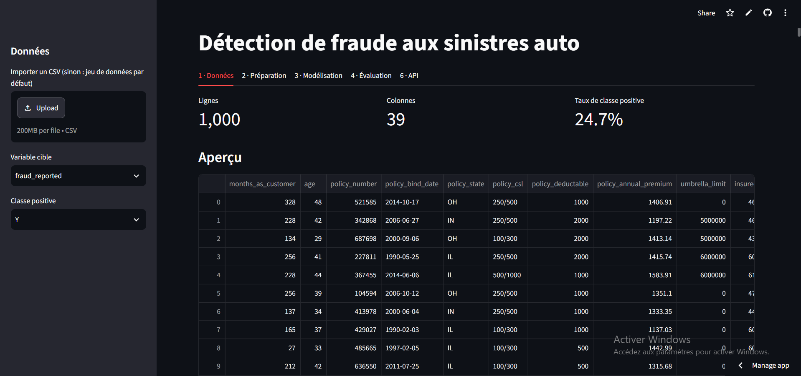
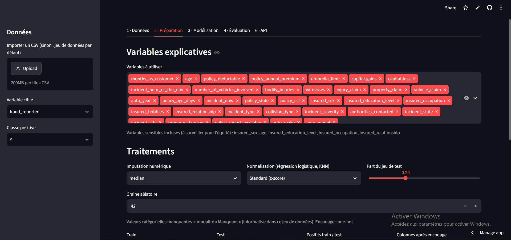
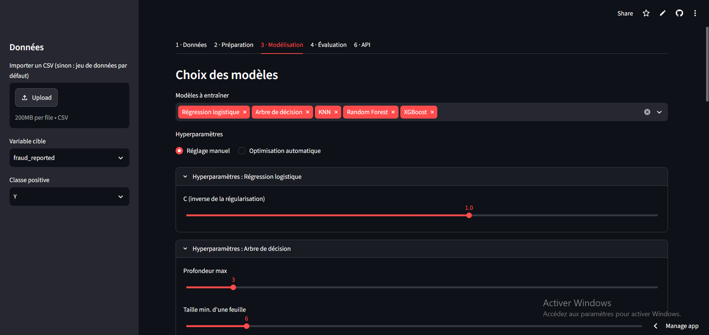
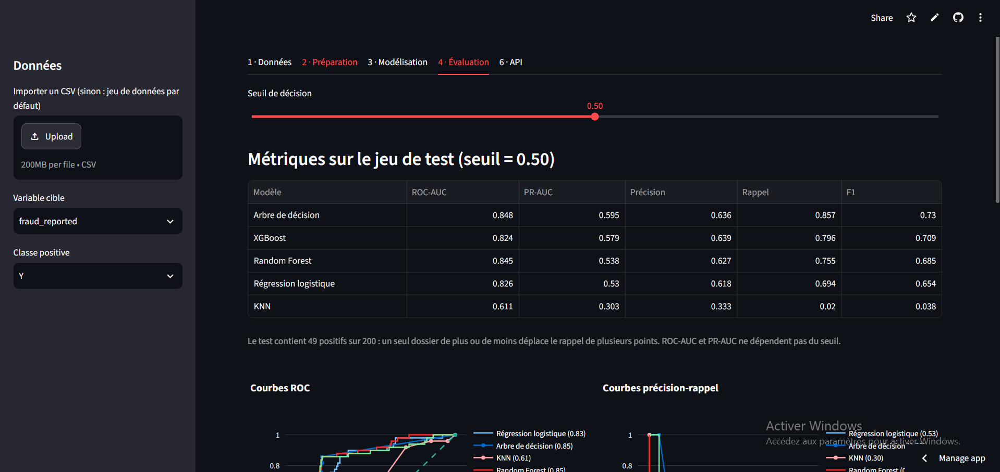
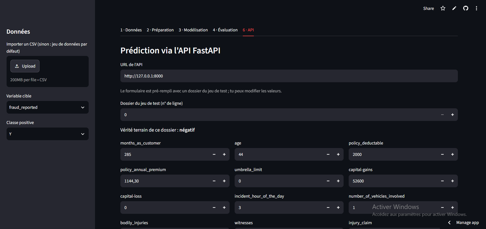

# Détection de fraude aux sinistres auto : classification interactive

Projet Challenge 1, Data Mining (II3-IA, ENSI 2026-2027), enseignante Rym Besrour.

Application web de machine learning qui charge un jeu de données de sinistres automobiles,
entraîne et compare cinq modèles de classification, et sert les prédictions via une API FastAPI.

## Liens

- Application déployée : https://fraude-auto-ml-explicable-8mml2f4xttygb3idhp9agm.streamlit.app
- Dépôt : https://github.com/eyaltifi-pixel/fraude-auto-ml-explicable

## Cas métier

- Cas n°5 du catalogue : Assurance, fraude aux sinistres auto
- Jeu de données : Auto Insurance Claims Fraud (1 000 dossiers, 39 colonnes, 24,7 % de fraudes)
- Cible : `fraud_reported`

## Fonctionnalités

| Module | Contenu |
|---|---|
| 1 · Données | Chargement automatique ou import CSV, statistiques, valeurs manquantes, graphiques exploratoires |
| 2 · Préparation | Choix des variables, imputation, normalisation, encodage, séparation train/test paramétrable |
| 3 · Modélisation | Régression logistique, arbre de décision, KNN, Random Forest, XGBoost ; hyperparamètres manuels ou optimisation automatique |
| 4 · Évaluation | ROC-AUC, PR-AUC, précision, rappel, F1, courbes superposées, matrice de confusion, curseur de seuil |
| 6 · API | Service FastAPI appelé par l'application (`/health`, `/models`, `/predict`) |

Le module 5 (Explainable AI) n'est pas inclus, à la demande de l'enseignante.

## Structure du dépôt

- `app.py` : application Streamlit
- `core.py` : chargement, préparation et modèles
- `api.py` : API FastAPI
- `Projet_Data_Mining_2.ipynb` : notebook de développement
- `requirements.txt` : dépendances

## Lancer en local

    pip install -r requirements.txt
    streamlit run app.py

L'application lance elle-même l'API sur le port 8000. La documentation interactive de l'API
est disponible sur http://127.0.0.1:8000/docs.

## Captures d'écran

## Limites

- Les modèles entraînés sont stockés dans un fichier unique : un réentraînement écrase le précédent.
- Sur l'hébergement gratuit, ce fichier disparaît au redémarrage de l'app.
- Jeu de test de petite taille : les métriques varient de plusieurs points d'un tirage à l'autre.
## Démo

▶️ [Voir la démo vidéo](https://drive.google.com/file/d/1-fIRDbZiic5FwLjyuLA8GNbX3CnMhUky/view?usp=sharing)
